  

  

  
  

 

### `// quem sou`

Olá! Sou a **Rafaella**, de São José dos Campos. Trabalho como **Software Developer na Ericsson**, em **AI R&D**, construindo **agentes de IA** com MCP e GraphRAG.

- 🎓 Finalizando **Banco de Dados** na **Fatec SJC**
- 💻 Desenvolvedora Web **Full-Stack** pela **Generation Brasil**
- 📋 Técnica em **Administração** pelo **CEPHAS**

### `// do que gosto`

🪐 espaço e céu estrelado &nbsp;·&nbsp; 🌿 natureza &nbsp;·&nbsp; 🌊 surf &nbsp;·&nbsp; 🏐 vôlei &nbsp;·&nbsp; ✈️ viajar

Meus projetos estão no [**portfólio**](https://arafaellacruz.github.io/) ✨

<b>🇺🇸 English</b>

 

Hi! I'm **Rafaella**, from São José dos Campos, Brazil. I'm a **Software Developer at Ericsson** (AI R&D), building **AI agents** with MCP and GraphRAG. I'm finishing my **Database Technology** degree at **Fatec SJC**, completed the **Full-Stack** bootcamp at **Generation Brazil** and hold a technical degree in **Administration**. I love space, nature, surfing, volleyball and travel.

 

### `// o que sei fazer`

  

 

